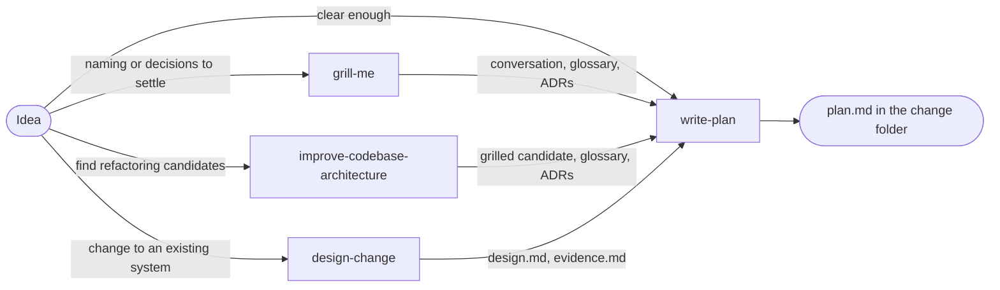
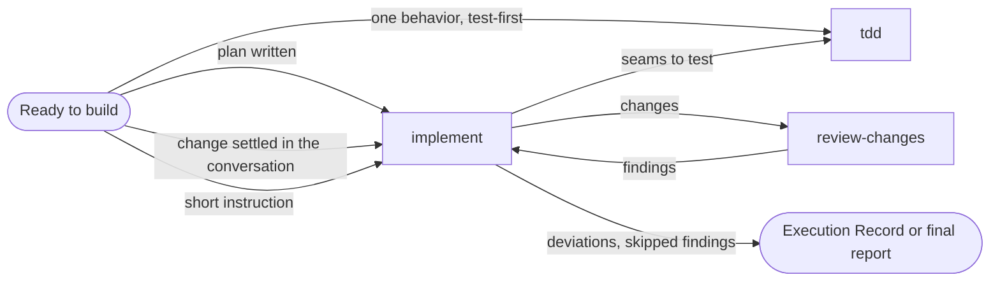
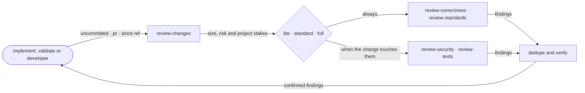
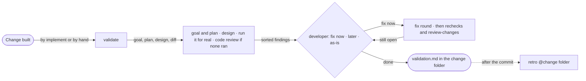
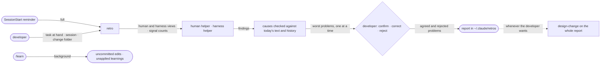
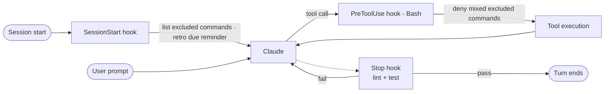

# dotclaude

Shared [Claude Code](https://docs.anthropic.com/en/docs/claude-code) configuration repo, symlinked into `~/.claude/` so edits here propagate to every project automatically.

Manage rules, skills, commands, agents, and hooks in one place instead of duplicating them across every project.

> **Note:** This repo contains scripts that modify files on your system. Please review the contents before use.
>
> **Platform:** Only tested and developed on macOS. Linux may work but is untested; Windows is not supported.

## SDLC Flow


### Planning



### Implementation



### Code Review



### Validation



### Retro



## Runtime Flow



*Excluded commands run outside the sandbox, but only when called alone.*

## Principles

**This repo treats AI as a new layer above code.** Just as languages lifted us above machine instructions without making them irrelevant, AI can write more code than a person can read, so the workflow around it becomes the interface between the person and the code. This repo engineers that workflow: the person stays in charge of goals and decisions, while the code is still held to the disciplines underneath — deep modules, behavior-first tests, the project's domain language.

The engineering skills rest on these tenets:

- **Deep modules** — small interfaces that hide a lot of functionality.
- **Behavior-first testing** — tests through public interfaces, built one vertical slice at a time.
- **Domain-grounded** — the project's glossary and recorded decisions.
- **Evidence over speculation** — explore the code and research before designing.
- **Goal-anchored** — every step serves the user's real goal, not only the literal request.
- **Validate continuously** — no stage hands off unchecked work.
- **Human-first** — every session pitched at the user's level of understanding.

**Self-improving harness.** `retro` judges past sessions and reports the problems you agree on, in your own words, for a design session to fix, and `learn` leaves lessons as uncommitted edits — every change to the harness is a git diff you review.

**Security-first defaults.** Claude runs smoothly inside a sandbox but can't read your secrets, change your machine, or touch remotes without asking — see [settings.json](#settingsjson).

## What's Included

### [Rules](rules/)

Rule files discovered automatically by Claude Code. A rule without `paths:` frontmatter is always loaded; a rule with `paths:` loads when Claude reads, edits, or creates a matching file.

| File | Loaded when | Description |
|------|-------------|-------------|
| [general.md](rules/general.md) | Always | Do only what is requested, no-guessing policy, consistency, dedicated file tools, fail-safe shell commands, check-before-implementing, docs sync, rules awareness |
| [py-code.md](rules/py-code.md) | Python files | Python style, KISS/YAGNI, error handling, data models |
| [py-test.md](rules/py-test.md) | Python test files | pytest conventions, parametrize patterns, test organization |
| [ts-code.md](rules/ts-code.md) | TypeScript files | TypeScript style, typing, naming, error handling |
| [ts-test.md](rules/ts-test.md) | TypeScript test files | Vitest conventions, mocking boundaries, determinism, test organization |
| [docs.md](rules/docs.md) | Markdown files | Documentation principles, timeless writing, avoid volatile details |

### [Shared](shared/)

Reference files explicitly read by commands and skills — not auto-loaded.

| File | Description |
|------|-------------|
| [shared/change-set.md](shared/change-set.md) | Finds the one change set to work on and gathers its overview |
| [shared/planning-context.md](shared/planning-context.md) | Glossary, ADR and rule loading plus the change folder layout, shared by the planning artifacts |
| [shared/domain-docs.md](shared/domain-docs.md) | Where the glossary and ADRs live, when to write them, and their formats — for every skill that records them |
| [shared/codebase-design.md](shared/codebase-design.md) | The deep-module vocabulary and principles for designing and discussing a module's shape |
| [shared/meet-the-user.md](shared/meet-the-user.md) | How interactive design, grilling and planning sessions pitch explanations and questions at the user's current level |

### [Commands](commands/)

| Command | Description |
|---------|-------------|
| [/skill-review](commands/skill-review.md) | Review a skill or command file for best practices — structure, writing style, progressive disclosure, and prompt engineering |

### [Skills](skills/)

| Skill | Description |
|-------|-------------|
| [prompt-engineering](skills/prompt-engineering/SKILL.md) | Prompt crafting and optimization techniques |
| [learn](skills/learn/SKILL.md) | Background capture of lessons from the current session and its permission prompts, left as uncommitted edits |
| [tdd](skills/tdd/SKILL.md) | Test-driven development with the red-green loop |
| [grill-me](skills/grill-me/SKILL.md) | Grill a plan or design until it's shared and sharp, recording settled terms and decisions in the project's domain docs |
| [design-change](skills/design-change/SKILL.md) | Turn a rough idea for changing an existing system into a code-checked design, written up as plain-language design docs before planning |
| [write-plan](skills/write-plan/SKILL.md) | Write a self-reviewed plan from a design, the current conversation, or a short prompt, saved in its change folder |
| [implement](skills/implement/SKILL.md) | Implement a plan, a change settled in the conversation, or a short instruction test-first via the tdd loop, then test, review, and verify against the goal |
| [review-changes](skills/review-changes/SKILL.md) | Independent background code review of uncommitted changes, a branch, or everything since a ref, sized to the change's risk; the session then judges and fixes the findings |
| [validate](skills/validate/SKILL.md) | Check a finished change against its goal, plan and design, and run it for real, before the diff review |
| [retro](skills/retro/SKILL.md) | Look back over past sessions and report the problems the developer agrees on, feedback first, each with its cause checked — no fixes |
| [pr-summary](skills/pr-summary/SKILL.md) | Brief, copyable PR summary grouped by feature/area, with evidence and risk when the change was validated |
| [commit-summary](skills/commit-summary/SKILL.md) | Pre-commit digest of the uncommitted changes — a plain summary, a changed-files tree and a suggested conventional commit message |
| [improve-codebase-architecture](skills/improve-codebase-architecture/SKILL.md) | Find module-deepening refactor opportunities, presented as an HTML report — or, in scoped mode, as a text review of what a design or plan touches |
| [py-debug](skills/py-debug/SKILL.md) | Python debugging |
| [ts-debug](skills/ts-debug/SKILL.md) | TypeScript/Node debugging |
| [plugin-browser](skills/plugin-browser/SKILL.md) | Browse, discover, and explore skills, agents, plugins and agent harness frameworks from curated community and official repos |

### [Agents](agents/)

| Agent | Description |
|-------|-------------|
| [documentation-manager](agents/documentation-manager.md) | Keeps docs in sync with code changes |

**[retro/](agents/retro/)**

| Agent | Description |
|-------|-------------|
| [retro-human](agents/retro/retro-human.md) | The developer's feedback, questions and skill usage in past sessions, dispatched by retro |
| [retro-harness](agents/retro/retro-harness.md) | Friction, procedure, review misses, automation and security in past sessions, dispatched by retro |

**[review/](agents/review/)**

| Agent | Description |
|-------|-------------|
| [review-correctness](agents/review/review-correctness.md) | Logic, edge cases, silent failures and broken interfaces in a change set, dispatched by review-changes |
| [review-standards](agents/review/review-standards.md) | The user's coding rules, simplicity and code smells in a change set, dispatched by review-changes |
| [review-security](agents/review/review-security.md) | Security issues in a change set that touches a security surface, dispatched by review-changes |
| [review-tests](agents/review/review-tests.md) | Missing and weak tests in a change set, dispatched by review-changes |

### [Hooks](hooks/)

Event-driven shell scripts registered in `settings.json`.

| Hook | Event | Description |
|------|-------|-------------|
| [standalone-excluded-commands.sh](hooks/standalone-excluded-commands.sh) | `PreToolUse` | Denies Bash calls that mix a `sandbox.excludedCommands` entry with other commands, since those run sandboxed. `list-excluded-commands.sh` lists these commands up front |
| [retro-reminder.sh](hooks/retro-reminder.sh) | `SessionStart` | Reminds at session start when no full retro ran recently; `DOTCLAUDE_RETRO_REMINDER_DAYS` sets how many days count as recent, `0` turns it off |
| [list-excluded-commands.sh](hooks/list-excluded-commands.sh) | `SessionStart` | Lists the `sandbox.excludedCommands` entries and how to call them so they run unsandboxed: alone, with no pipes, `$()`, backticks or redirects |
| [lint-and-test.sh](hooks/lint-and-test.sh) | `Stop` | Runs the `lint` and `test` targets (`make` or `task`) in each repo edited since the last user prompt, blocking on failures or missing targets; `DOTCLAUDE_DISABLE_AUTO_LINT` / `DOTCLAUDE_DISABLE_AUTO_TEST` set to `1`/`true` skip them |

### [Output Styles](output-styles/)

Markdown files that modify Claude Code's system prompt to change its role, tone, and default response format. Activate one with `/output-style <name>`, via `/config` → **Output style**, or set `outputStyle` in a settings file. Takes effect from the next message; restart Claude Code after editing a style file.

| Style | Description |
|-------|-------------|
| [lean](output-styles/lean.md) | Terse by default — hard length caps, leads with the answer, holds its ground under pushback, expands only on request |

### [Scripts](scripts/)

| File | Description |
|------|-------------|
| [statusline-command.sh](scripts/statusline-command.sh) | Custom status line script |
| [check-commands.sh](scripts/check-commands.sh) | Prints the command that runs a project's `lint` and `test` targets, or `none`, for the Stop hook and the engineering skills |
| [sessions.py](scripts/sessions.py) | Finds session transcripts and writes compact outlines and friction counts of them, for `retro` and `learn` |
| [transcript.py](scripts/transcript.py) | Reads one session transcript's entries into outline lines and permission outcomes, for `sessions.py` |

### [settings.json](settings.json)

Shared permissions, preferences, and security posture. Built for auto mode: the sandbox and the auto mode classifier handle routine safety, so Claude works without prompt fatigue, while explicit rules hold a few hard lines:

- **Secrets stay unreadable** — credential files, keychain, `.env` files, tokens in the environment, and forge auth tokens and CI secrets.
- **Whole-history rewrites need your OK** — they prompt; routine local git work is left to auto mode.
- **Remote changes need your OK** — pushes and forge writes prompt; forge deletions are denied; reads run freely. In auto mode, opening MRs/PRs and routine collaboration on them (editing the description, commenting, replying to and resolving discussions) runs without a prompt, while forge configuration changes stay blocked.
- **Settings changes need your OK** — Claude's edits to a settings file prompt, and auto mode blocks settings changes made any other way.
- **The machine stays untouched** — system settings, services, shell config, and package installs outside the project prompt or are denied.
- **File edits stay in the project** — Claude's file tools refuse writes outside the working directories and this repo's linked config; add another directory with `/add-dir`.
- **No phoning home** — telemetry and error reporting are off.
- **Docker is the exception** — it runs outside the sandbox and only auto mode judges it, so a container can reach secrets and the machine that the lines above keep from Claude.

Only a listed set of tools that can't work inside the sandbox run outside it — Claude can't take any other command out of the sandbox on its own — and Claude's package caches are kept separate from yours. This repo's linked config is readable without a prompt and from the sandbox in any project, and skill reference repos are writable from it too, so their maintenance scripts run anywhere.

## Setup

### Prerequisites

- [Claude Code](https://docs.anthropic.com/en/docs/claude-code) installed
- Project-level Claude memory lives at `.claude/CLAUDE.md` (not a root-level `CLAUDE.md`) — commands and agents that read or write project memory assume this path
- Recommended: `lint` and `test` targets in each project's `Makefile` or `Taskfile`, which the Stop hook runs after edits; without them, Claude is asked to run the project's own commands

### Installation

```bash
make install
```

This runs `setup/install.sh`, which symlinks this repo into `~/.claude/` (the lists live in `setup/lib/targets.sh`):
- **Directory entries**: each top-level entry of a linked directory gets its own symlink inside a real `~/.claude/<dir>/` (e.g. `~/.claude/skills/tdd -> repo/skills/tdd`); entries git ignores, such as `__pycache__`, are skipped. Content Claude Code ships into those directories itself, such as `skills/synced/`, lives alongside and is never touched.
- **Files**: `settings.json`
- **Folders**: `retros/`, linked whole as `~/.claude/retros`; its own `.gitignore` keeps everything in it out of git, since it holds notes drawn from your sessions.

Dangling links to entries removed from the repo are pruned; run `make uninstall` before moving the repo, or its old links are left behind. If a non-repo entry with the same name already exists, the script warns and skips it. An existing real `settings.json` is backed up with a timestamp before being replaced.

The script prints only what it changed, so it is safe to re-run. Re-run it after adding or removing a top-level entry so the change is linked.

### MCP servers

```bash
make mcp
```

Registers the `context7` MCP server at user scope, so it is available in every project. Safe to re-run — an existing entry is replaced.

### Uninstallation

```bash
make uninstall
```

Removes only symlinks pointing into this repo, then any `~/.claude/<dir>/` left empty. Everything else is left untouched, including the retro reports in `retros/`. If a backup exists for a file, the most recent backup is restored.

## Using It

### Configuration levels

Claude Code merges configuration from two levels:

| Level | Location | Scope |
|-------|----------|-------|
| User-level | `~/.claude/` (this repo, via symlinks) | All projects |
| Project-level | `project/.claude/` | That project only |

Array settings (e.g. `permissions.allow`) concatenate across levels. Project-level wins for same-named items.

After installing dotclaude, each project's `.claude/` should only contain project-specific overrides:

```
project/.claude/
├── CLAUDE.md              # project-specific instructions
├── settings.json          # project permissions, MCP servers
├── settings.local.json    # personal overrides (gitignored)
├── .gitignore
├── rules/                 # project-specific rules only (if any)
└── skills/                # project-specific skills only (if any)
```

### Editing workflow

Because the entries in `~/.claude/` are symlinks into this repo, editing any file in `~/.claude/rules/`, `~/.claude/skills/`, etc. is editing the real file here. Changes are immediately visible in all projects.

Create **new** top-level entries (a rule, skill, agent, hook, …) in this repo, not under `~/.claude/` — a file created there is not in the repo. Link them with `make install`.

Commit and push from this repo to version-control shared config. No need to touch project repos when updating shared configuration.

## Development

### Dependencies

Linting requires Python dev dependencies, declared in `pyproject.toml` and managed with [uv](https://docs.astral.sh/uv/):

```bash
uv sync
```

`make lint` fails on any line longer than 120 characters in tracked or untracked (non-ignored) `.sh` and `.py` files.
It also lints `.sh` files with [ShellCheck](https://www.shellcheck.net/), which must be installed separately (e.g. `brew install shellcheck`). `make test` runs the behavior tests in `tests/` (needs `git`, `jq`, `make`, `python3`), and checks the repo's own rules: each command opts out of model invocation, and each linked entry is listed in this README and installed.

### Conventions

- **No project-specific content here.** Rules, commands, or skills referencing a specific project's paths belong in that project's `.claude/`.
- **File-type rules** go in `rules/` with a `paths:` frontmatter listing the globs they apply to.
- **Lint and test commands** come from `check-commands.sh` — skills and hooks don't name a runner themselves.

## Acknowledgments

- [coleam00/context-engineering-intro](https://github.com/coleam00/context-engineering-intro) — inspiration for some commands and rules
- [trailofbits/claude-code-config](https://github.com/trailofbits/claude-code-config) — security and privacy focused settings
- [EveryInc/compound-engineering-plugin](https://github.com/EveryInc/compound-engineering-plugin) — naming conventions, code review, validation, planning and implementation practices; multi-session retro with generalist helpers batched by session; causes checked against git history, and problems agreed with reasons
- [addyosmani/agent-skills](https://github.com/addyosmani/agent-skills) — planning and implementation practices; independent review that sees only the change and its contract
- [wshobson/agents](https://github.com/wshobson/agents) — Python style and naming patterns; interface-as-contract documentation
- [anthropics/claude-plugins-official](https://github.com/anthropics/claude-plugins-official) — multi-agent code review pattern; fix now, later or as-is triage; feedback signals in the developer's words
- [coleam00/archon](https://github.com/coleam00/archon) — plugin-browser skill reference repo
- [affaan-m/ECC](https://github.com/affaan-m/ECC) — plugin-browser skill reference repo; a verdict per learning before anything is written
- [mattpocock/skills](https://github.com/mattpocock/skills) — source of the engineering skills, planning and implementation practices; code smell baseline and one-way-door risk in review; steps that changed nothing, as removal candidates
- [ghostsecurity/skills](https://github.com/ghostsecurity/skills) — codebase exploration heuristics
- [trailofbits/skills](https://github.com/trailofbits/skills) — evidence-based code analysis patterns; walking the diff in reading order
- [obra/superpowers](https://github.com/obra/superpowers) — planning and implementation practices; bounded fix loop; session analysis by independent checks citing session moments
- [backnotprop/pstack](https://github.com/backnotprop/pstack) — blast-radius risk analysis around the one fact a change is safe because of; context the developer handed over
- [openai/plugins](https://github.com/openai/plugins) — story-anchored run-for-real verification and patch-risk analysis
