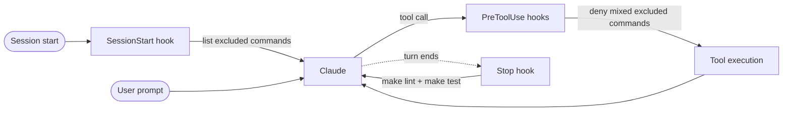

# dotclaude

Shared [Claude Code](https://docs.anthropic.com/en/docs/claude-code) configuration repo, symlinked into `~/.claude/` so edits here propagate to every project automatically.

Manage rules, skills, commands, agents, hooks, and templates in one place instead of duplicating them across every project.

> **Note:** This repo contains scripts that modify files on your system. Please review the contents before use.
>
> **Platform:** Only tested and developed on macOS. Linux may work but is untested; Windows is not supported.

## Why this design

Symlinking into `~/.claude/` and version-controlling everything in git turns this repo into the substrate for the `learn` skill: when Claude updates a rule, skill, or command based on session feedback, the change goes live in every project immediately and shows up as a reviewable git diff — making self-improvement auditable rather than a black box.

**Security-first defaults.** Claude runs smoothly inside a sandbox but can't read your secrets, change your machine, or touch remotes without asking — see [settings.json](#settingsjson).

**Scope.** This repo configures Claude Code — it does not bundle a linter or test runner. The Stop hook delegates to whatever the host project uses (`make lint`, `make test`); it skips gracefully when those targets aren't defined.

**Engineering philosophy.** A single stance runs through the engineering artifacts here: deep modules behind simple interfaces, behavior-first testing, and design grounded in the project's domain language.

## Runtime Flow



## What's Included

### [Rules](rules/)

Rule files discovered automatically by Claude Code. A rule without `paths:` frontmatter is always loaded; a rule with `paths:` loads when Claude reads, edits, or creates a matching file.

| File | Loaded when | Description |
|------|-------------|-------------|
| [general.md](rules/general.md) | Always | No-guessing policy, consistency, check-before-implementing, docs sync, rules awareness |
| [py-code.md](rules/py-code.md) | Python files | Python style, KISS/YAGNI, error handling, data models |
| [py-test.md](rules/py-test.md) | Python test files | pytest conventions, parametrize patterns, test organization |
| [ts-code.md](rules/ts-code.md) | TypeScript files | TypeScript style, typing, naming, error handling |
| [ts-test.md](rules/ts-test.md) | TypeScript test files | Vitest conventions, mocking boundaries, determinism, test organization |
| [docs.md](rules/docs.md) | Markdown files | Documentation principles, timeless writing, avoid volatile details |

### [Shared](shared/)

Reference files explicitly read by commands and skills — not auto-loaded.

| File | Description |
|------|-------------|
| [shared/change-set.md](shared/change-set.md) | Finds the one Change set to work on — from a Project repo, a Project worktree, or an Index repo — and gathers its overview (root, branch, diff base, changed files); lists the candidates and stops when there are several |
| [shared/code-review.md](shared/code-review.md) | Subagent-based review orchestration protocol with parallel batch analysis, lint/test checks, and numbered findings reported in the session |

### [Commands](commands/)

**[explore/](commands/explore/)**

| Command | Description |
|---------|-------------|
| [/overview](commands/explore/overview.md) | Build a lightweight, high-level overview of a project |
| [/architecture](commands/explore/architecture.md) | Discover a module's architecture, functionality, and communication interfaces, saved to `docs/architecture/` — excludes tests and CI/CD |

**[git/](commands/git/)**

| Command | Description |
|---------|-------------|
| [/commit-msg](commands/git/commit-msg.md) | Generate a suggested conventional commit message for the current changes. Runs in an isolated subagent, so diffs stay out of the session |
| [/pr-summary](commands/git/pr-summary.md) | Brief PR summary grouped by feature/area. Runs in an isolated subagent, so diffs stay out of the session |

**[review/](commands/review/)**

| Command | Description |
|---------|-------------|
| [/pr-review](commands/review/pr-review.md) | Technical code review of a branch against its base branch. A background reviewer that doesn't see the session's context runs it; when its numbered findings arrive, the session evaluates them and fixes the ones that hold up. Trailing text is a focus hint. Runs `make lint` / `make test`, honoring the same `DOTCLAUDE_DISABLE_AUTO_LINT` / `DOTCLAUDE_DISABLE_AUTO_TEST` opt-outs as the Stop hook |
| [/delta-review](commands/review/delta-review.md) | Same review for uncommitted changes against the latest commit |
| [/skill-review](commands/review/skill-review.md) | Review a skill or command file for best practices — structure, writing style, progressive disclosure, and prompt engineering |

**[plan/](commands/plan/)**

| Command | Description |
|---------|-------------|
| [/to-plan](commands/plan/to-plan.md) | Synthesize the current conversation into a plan saved under `.claude/plans/` — pairs with the `grill-with-docs` skill |
| [/generate-plan](commands/plan/generate-plan.md) | Generate a plan from a short prompt by researching the target area of the codebase autonomously, saved under `.claude/plans/` |
| [/refine-plan](commands/plan/refine-plan.md) | Refine a plan in place — check logical correctness and rule compliance, then edit the plan to fix issues |
| [/execute-plan](commands/plan/execute-plan.md) | Execute a plan test-first — internalize, sequence the work, implement via the tdd red-green-refactor loop, validate, and verify |

**[skill-references/](commands/skill-references/)**

| Command | Description |
|---------|-------------|
| [/refresh-references](commands/skill-references/refresh-references.md) | Sync and audit the plugin-browser and agent-harness reference repos against upstream, then refine each catalog's sparse patterns and descriptions and re-index |

### [Skills](skills/)

Skills must live flat under `skills/` — Claude Code only discovers a skill whose `SKILL.md` is one level deep, so there are no subdirectories to group by.

| Skill | Description |
|-------|-------------|
| [prompt-engineering](skills/prompt-engineering/SKILL.md) | Prompt crafting and optimization techniques |
| [learn](skills/learn/SKILL.md) | Self-improvement from conversation feedback |
| [tdd](skills/tdd/SKILL.md) | Test-driven development with the red-green-refactor loop |
| [grill-with-docs](skills/grill-with-docs/SKILL.md) | Grill design decisions, maintaining a CONTEXT.md glossary & ADRs |
| [improve-codebase-architecture](skills/improve-codebase-architecture/SKILL.md) | Find module-deepening refactor opportunities, presented as an HTML report |
| [py-debug](skills/py-debug/SKILL.md) | Python debugging |
| [ts-debug](skills/ts-debug/SKILL.md) | TypeScript/Node debugging |
| [plugin-browser](skills/plugin-browser/SKILL.md) | Browse, discover, and explore skills/agents/plugins from multiple indexed community and official repos |
| [agent-harness](skills/agent-harness/SKILL.md) | Browse and explore agent harness frameworks and Claude Code resource collections from multiple indexed repos |

### [Agents](agents/)

| Agent | Description |
|-------|-------------|
| [documentation-manager](agents/documentation-manager.md) | Keeps docs in sync with code changes |

**[review/](agents/review/)**

| Agent | Description |
|-------|-------------|
| [code-reviewer](agents/review/code-reviewer.md) | Focused code reviewer for batches of changed files, dispatched by review commands |

### [Hooks](hooks/)

Event-driven shell scripts registered in `settings.json`.

| Hook | Event | Description |
|------|-------|-------------|
| [standalone-excluded-commands.sh](hooks/standalone-excluded-commands.sh) | `PreToolUse` | Denies Bash calls that mix a `sandbox.excludedCommands` entry with other commands, since those run sandboxed. `list-excluded-commands.sh` lists these commands up front |
| [list-excluded-commands.sh](hooks/list-excluded-commands.sh) | `SessionStart` | Lists the `sandbox.excludedCommands` entries and how to call them so they run unsandboxed: alone, with no pipes, `$()`, backticks or redirects |
| [lint-and-test.sh](hooks/lint-and-test.sh) | `Stop` | For non-gitignored files changed by Edit or Write since the last user prompt, runs `make lint` and `make test` in each file's git root — so edits in several repos or worktrees each run their own targets. Exits with code 2 to block and prompt Claude to fix failures; skips files outside a git repo and targets the root's Makefile doesn't define. `make lint` is skipped when `DOTCLAUDE_DISABLE_AUTO_LINT` is set to `1`/`true`; `make test` when `DOTCLAUDE_DISABLE_AUTO_TEST` is set to `1`/`true` |

### [Output Styles](output-styles/)

Markdown files that modify Claude Code's system prompt to change its role, tone, and default response format. Activate one via `/config` → **Output style**, or set `outputStyle` in a settings file. Takes effect after `/clear` or a new session.

| Style | Description |
|-------|-------------|
| [lean](output-styles/lean.md) | Terse by default, built to be read fast — leads with the answer, trades grammar for concision in replies, cuts filler and bloated comments, holds its ground under pushback, expands only when an idea truly needs the room |

### [Templates](templates/)

| File | Description |
|------|-------------|
| [plan-template.md](templates/plan-template.md) | Plan artifact structure used by the `/to-plan` and `/generate-plan` commands |

### [Scripts](scripts/)

| File | Description |
|------|-------------|
| [statusline-command.sh](scripts/statusline-command.sh) | Custom status line script |
| [skill_references.py](scripts/skill_references.py) | Syncs a skill's catalog-listed reference repos with their sparse patterns, or audits them for upstream layout changes |

### [settings.json](settings.json)

Shared permissions, preferences, and security posture. Built for auto mode: the sandbox and the auto mode classifier handle routine safety, so Claude works without prompt fatigue, while explicit rules hold a few hard lines:

- **Secrets stay unreadable** — credential files, keychain, `.env` files, tokens in the environment, and forge auth tokens and CI secrets.
- **Git history changes need your OK** — commits, merges, rebases, resets, and other history rewrites prompt; worktree management runs freely.
- **Remote changes need your OK** — pushes and forge writes prompt; forge deletions are denied; reads run freely.
- **The machine stays untouched** — system settings, services, shell config, and package installs outside the project prompt or are denied.
- **No phoning home** — telemetry and error reporting are off.

Only a listed set of tools that can't work inside the sandbox run outside it — Claude can't take any other command out of the sandbox on its own — and Claude's package caches are kept separate from yours. Skill reference repos under `~/.claude/skills-references/` are readable and writable from the sandbox, so their sync and audit scripts run from any project. The linked `~/.claude/` directories (rules, skills, agents, commands, …) are readable without a prompt and from the sandbox, in any project.

## How It Works

Claude Code merges configuration from two levels:

| Level | Location | Scope |
|-------|----------|-------|
| User-level | `~/.claude/` (this repo, via symlinks) | All projects |
| Project-level | `project/.claude/` | That project only |

Array settings (e.g. `permissions.allow`) concatenate across levels. Project-level wins for same-named items.

## Prerequisites

- [Claude Code](https://docs.anthropic.com/en/docs/claude-code) installed
- A `Makefile` in each project with at least: `lint`, `test`, `tree` targets
- Project-level Claude memory lives at `.claude/CLAUDE.md` (not a root-level `CLAUDE.md`) — commands and agents that read or write project memory assume this path

### claude-context

The claude-context MCP server (registered by `make mcp`) needs:
- an embedding provider: OpenAI, with `OPENAI_API_KEY` set in this repo's `.env`, or a local Ollama
- a locally running instance of Milvus vector db
    - check out [this repo](https://github.com/berekvolgyipeter/milvus) to run Milvus via Docker Compose

## Installation

```bash
make install
```

This runs `setup/install.sh`, which symlinks this repo into `~/.claude/` (the lists live in `setup/lib/targets.sh`):
- **Directory entries**: each top-level entry of a linked directory gets its own symlink inside a real `~/.claude/<dir>/` (e.g. `~/.claude/skills/tdd -> repo/skills/tdd`). Content Claude Code ships into those directories itself, such as `skills/synced/`, lives alongside and is never touched.
- **Files**: `settings.json`

Dangling links to entries removed from the repo are pruned; run `make uninstall` before moving the repo, or its old links are left behind. If a non-repo entry with the same name already exists, the script warns and skips it. An existing real `settings.json` is backed up with a timestamp before being replaced.

The script prints only what it changed, so it is safe to re-run. Re-run it after adding or removing a top-level entry so the change is linked.

### MCP servers

```bash
make mcp
```

Registers the `claude-context` and `context7` MCP servers at user scope, so they are available in every project. It asks for the embedding provider: OpenAI reads the key from this repo's `.env` at server launch, so no key is stored in Claude Code's config; Ollama asks for the model and host. Safe to re-run — existing entries are replaced.

## Uninstallation

```bash
make uninstall
```

Removes only symlinks pointing into this repo, then any `~/.claude/<dir>/` left empty. Everything else is left untouched. If a backup exists for a file, the most recent backup is restored.

## Development Dependencies

Linting requires Python dev dependencies, declared in `pyproject.toml` and managed with [uv](https://docs.astral.sh/uv/):

```bash
uv sync
```

`make lint` also lints `.sh` files with [ShellCheck](https://www.shellcheck.net/), which must be installed separately (e.g. `brew install shellcheck`). `make test` runs the behavior tests in `tests/` (needs `git`, `jq`, `make`).

## Editing Workflow

Because the entries in `~/.claude/` are symlinks into this repo, editing any file in `~/.claude/rules/`, `~/.claude/skills/`, etc. is editing the real file here. Changes are immediately visible in all projects.

Create **new** top-level entries (a rule, skill, agent, hook, …) in this repo, not under `~/.claude/` — a file created there is not in the repo. Link them with `make install`.

Commit and push from this repo to version-control shared config. No need to touch project repos when updating shared configuration.

## Project-Level Layer

After installing dotclaude, each project's `.claude/` should only contain project-specific overrides:

```
project/.claude/
├── CLAUDE.md              # project-specific instructions
├── settings.json          # project permissions, MCP servers
├── settings.local.json    # personal overrides (gitignored)
├── .gitignore
├── rules/                 # project-specific rules only (if any)
└── skills/                # project-specific skills only (if any)
```

## Conventions

- **No project-specific content here.** Rules, commands, or skills referencing a specific project's paths belong in that project's `.claude/`.
- **File-type rules** go in `rules/` with a `paths:` frontmatter listing the globs they apply to.
- **Templates** should be referenced via absolute path: `~/.claude/templates/plan-template.md`.
- **`make lint` / `make test`** in shared commands are acceptable — all projects are assumed to use a Makefile.

## Acknowledgments

- [coleam00/context-engineering-intro](https://github.com/coleam00/context-engineering-intro) — inspiration for some commands and rules
- [trailofbits/claude-code-config](https://github.com/trailofbits/claude-code-config) — security and privacy focused settings
- [EveryInc/compound-engineering-plugin](https://github.com/EveryInc/compound-engineering-plugin) — naming conventions and code review patterns
- [wshobson/agents](https://github.com/wshobson/agents) — Python style and naming patterns; interface-as-contract documentation
- [anthropics/claude-plugins-official](https://github.com/anthropics/claude-plugins-official) — multi-agent code review pattern
- [coleam00/archon](https://github.com/coleam00/archon) — agent-harness skill reference repo
- [affaan-m/ECC](https://github.com/affaan-m/ECC) — agent-harness skill reference repo
- [mattpocock/skills](https://github.com/mattpocock/skills) — source of the engineering skills (tdd, grill-with-docs, improve-codebase-architecture) and the `/to-plan` command
- [ghostsecurity/skills](https://github.com/ghostsecurity/skills) — codebase exploration heuristics
- [trailofbits/skills](https://github.com/trailofbits/skills) — evidence-based code analysis patterns
- [obra/superpowers](https://github.com/obra/superpowers) — interface-first module mapping and TDD framing in the plan template
